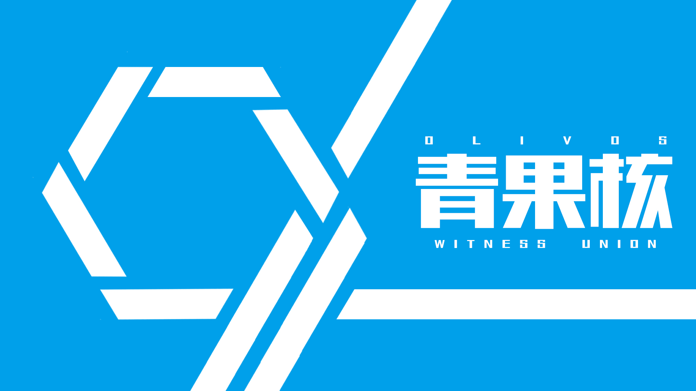

  

# OlivOS Companion

**OlivOS 多实例 WebUI 客户端** 
中文名称：**OlivOS 托盘** 
**Witness Union / 见证联合**

<a href="#功能">功能</a>
·
<a href="#下载">下载</a>
·
<a href="#开始使用">开始使用</a>
·
<a href="docs/README.md">开发文档</a>
·
<a href="#许可证">许可证</a>

OlivOS Companion 是一个跨平台的 OlivOS WebUI 客户端，用桌面或移动设备快速进入并切换多个 OlivOS 实例。它不包含 OlivOS 本体，也不修改 OlivOS 源代码，需要配合已经部署好的 OlivOS WebUI 使用。

## 功能

- **多实例管理**：为每个 OlivOS 实例保存名称、WebUI 地址和登录信息，在列表中快速切换。
- **接近原生的 WebUI 体验**：在应用内直接打开 OlivOS WebUI，并显示已读取到的 OlivOS 版本。
- **主题同步**：应用与 WebUI 内切换亮/暗模式时，标题栏、状态栏和 WebUI 主题保持一致。
- **配置导入导出**：支持从剪贴板、二维码图片或相机扫码导入实例；可导出全部或选定实例，也支持批量选择。
- **自动登录**：可将 WebUI 密码保存到系统安全存储，启动实例时自动登录。

## 下载

从 [GitHub Releases](https://github.com/OlivOS-Team/OlivOS-Companion/releases) 下载对应平台产物。

| 平台 | 产物 | 说明 |
| --- | --- | --- |
| Windows（推荐） | `olivos-companion-windows-setup-x64.exe` | 安装版，安装到 `Program Files`，创建开始菜单快捷方式，并检测/安装 VC++ 运行库。 |
| Windows | `olivos-companion-windows-portable-x64.zip` | 便携版，解压即用；目标机器仍需 VC++ 2015-2022 x64 和 WebView2 Runtime。 |
| Android | `olivos-companion-android-release.apk` | 支持覆盖升级；签名说明见开发文档。 |
| macOS | `olivos-companion-macos.zip` | 解压后运行 `.app`。 |
| iOS | `olivos-companion-ios.zip` | 未签名构建，需要自行签名安装。 |

- Windows 安装器支持简体中文和 English，并显示对应语言的 AGPLv3 文本。
- 安装器、窗口标题和桌面/应用列表名称会跟随系统语言：中文显示为「OlivOS 托盘」，英文显示为「OlivOS Companion」。
- Windows 安装包目前未签名，SmartScreen 可能提示；可在 Releases 中核对每个产物旁的 `.sha256` 文件。
- Android 如果覆盖安装时提示签名不一致，请先卸载旧版一次；签名与发布细节见 [CI 与构建](docs/ci.md)。

## 开始使用

1. 启动 OlivOS，并确认它的 WebUI 可以在当前设备访问，例如 `http://192.168.1.10:20480`。
2. 打开 OlivOS Companion，点击右上角“添加”，填写实例名称（可选）、WebUI 地址和密码；需要自动登录时打开“自动登录”。
3. 保存后点击实例卡片即可进入 WebUI；返回实例列表即可切换到其他实例。
4. 已有配置可以通过剪贴板导入，也可以导入二维码图片，或使用移动端相机扫码。

## 导入与导出

- 右上角“导出”支持导出到剪贴板或生成二维码；实例卡片菜单可以导出单个实例。
- 二维码可保存到本地：移动端保存到相册，桌面端选择保存位置。
- 实例较多时二维码可能超出容量，请改用剪贴板导出。
- 导出格式为 `olivoscompanionconf://` 加 Base64 配置；这不是加密，剪贴板和二维码都会包含自动登录密码，请勿发送给不可信的人。
- 导入时相同 WebUI 地址的实例会更新，新地址会新增。

## 数据位置

- **Windows 安装版**：
  - 实例与版本缓存：`%APPDATA%\com.olivosteam\olivos_companion`
  - WebView2 数据：`%LOCALAPPDATA%\com.olivosteam\olivos_companion\WebView2`
- **Windows 便携版**：数据保存在 exe 同目录的 `userdata` 中；目录里的 `portable.flag` 表示便携模式。
- **Android / iOS / macOS**：数据由系统应用沙盒管理。
- 自动登录密码保存到系统安全存储；Windows 使用 DPAPI 并绑定当前用户，复制便携目录到其他用户或电脑后需要重新输入密码。
- 更详细的目录和版本迁移说明见 [数据与运行目录](docs/data-layout.md)。

## 许可证

本项目使用 GNU Affero General Public License v3（AGPL-3.0）发布，完整协议文本见 [LICENSE](LICENSE)。

安装器的中文界面展示基于开放原子开源基金会「源译识」项目整理的中英双语参考译文；该译文为非官方译文，不具法律效力，以英文原文为准：

- 参考译文来源：<https://legal.openatom.tech/zones/licenses/article/mJh21bfxVv6>
- 英文原文：<https://www.gnu.org/licenses/agpl-3.0.en.html>

## 开发

开发环境、构建与发布、Android 签名和原生调试说明见 [开发文档](docs/README.md)：

- [开发环境与磁盘约定](docs/dev-environment.md)
- [CI 与构建](docs/ci.md)
- [Visual Studio 调试](docs/visual-studio.md)
- [数据与运行目录](docs/data-layout.md)

## 声明

OlivOS 名称、图标及相关品牌归 OlivOS 项目及其贡献者所有。

> 世界是属于每一个人的。要创造一个充满逻辑并尊重每一个人的世界。
>
> ——А. Бабуров, А. Гутнов, И. Лежава и др.《Новый элемент расселения: на пути к новому городу》. Москва: Стройиздат, A.D. 1966.
